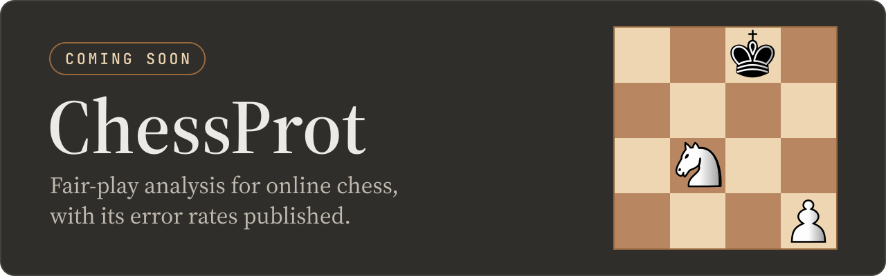

  

  # NorthProt

  **Pioneering the Future of AGI & Human-AI Collaboration**

   

  
  

   

  

    NorthProt is a technology startup based in Vancouver, dedicated to pushing the boundaries of Artificial General Intelligence. 
    We believe in a future where <b>Autonomous Agents</b> and Humans build the world together. 
    Now building <b>ChessProt</b>.
  

---

## ♟️ ChessProt coming soon

**Fair-play analysis for online chess, with its error rates published.**

- Built for Lichess and chess.com games and players. It gives a statistic, not a
  verdict: every score comes with how often honest players at that level score as high.
- Shows a score only where it has been validated on held-out games, per platform, rating
  band and time control. Everywhere else the site says "not validated".
- The measured error rates go on a public methodology page at launch.

**Where it stands**

`● Research` → `○ Data` → `○ First gate` → `○ Refinement` → `○ Site` → `○ Launch`

ChessProt launches only after its model clears a pass mark set in advance, on games it
never saw.

---

## Projects

| Project | What it is | Status |
|---|---|---|
| ♟️ **ProtChess** | A clean-room chess engine in Rust with several playing styles. |  |
| 🎙️ **prot** | Real-time voice conversation with the Axel persona: streaming speech in and out, long-term memory. |  |
| 🧠 **Axel** | An autonomous agent with layered long-term memory, in Python and TypeScript. |  |
| ⌨️ **protly** | Write in Korean or English, send in English: a Chrome extension and an iPhone keyboard. |  |
| ☕ [**CodeProt**](https://codeprot.vercel.app) | A Java practice judge for intro programming courses. |  |
| 🎓 [**brightspace-mcp**](https://github.com/NorthProt-Inc/brightspace-mcp) | An MCP server that connects Claude Code to D2L Brightspace. |  |

---

© 2026 NorthProt Inc. · Vancouver, BC

